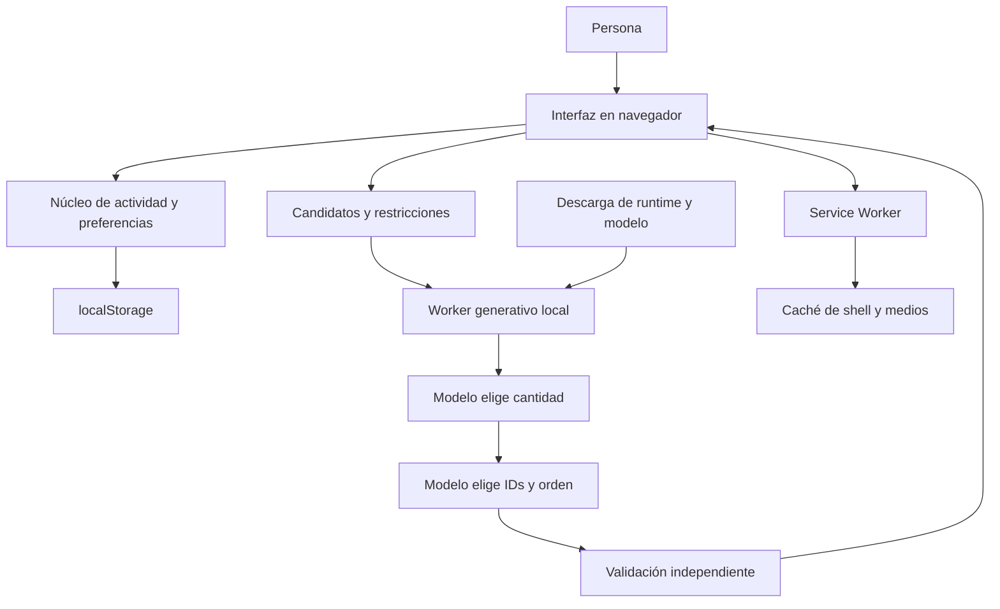

# Arquitectura · PWA estática y ejecución local

## Componentes

Hosting distribuye archivos; no recibe la descripción mediante una API de inferencia. Las descargas externas sí transportan metadatos normales de red. El Worker aísla trabajo generativo del hilo de interfaz.

| Archivo | Responsabilidad |
|---|---|
| app.js | Navegación, rutinas estáticas, biblioteca, preferencias, actividad y diálogos |
| core.js | Normalización y cálculos puros de tiempo, actividad, fechas y estado |
| data.js | Catálogo inicial y rutinas existentes |
| fullbody.js | Metadatos de los 112 medios adicionales |
| agent-core.js | Evaluar contexto y producir candidatos compatibles; items permanece vacío |
| agent-planner.js | Payload, mensajes, longitudes viables, gramáticas y validación |
| agent-worker.js | Cargar pipeline local y ejecutar cantidad → selección |
| agent-ui.js | Formulario, petición/cancelación, contexto obsoleto, resultado y sesión de guía |
| sw.js | Shell versionado y caché de medios; red primero para código |

## Contrato de composición

1. `prepare` recibe descripción, zona, cansancio, modalidad, posición, permiso de suelo, zonas/IDs excluidos y catálogo.
2. Devuelve nivel, contexto y candidatos anotados; nunca una rutina presentada como inferida. Errores/alarma terminan con estado explícito.
3. `counts` calcula longitudes que pueden completarse respetando restricciones. Pausa ágil añade hasta tres; normal usa familias disponibles.
4. Primera inferencia: JSON `{"count":N}` restringido a longitudes viables.
5. Segunda inferencia: JSON `{"pick":[...]}` de índices, con longitud exacta N y posibilidad de completar cobertura/posiciones.
6. El hilo principal vuelve a comprobar contexto y valida cantidad, IDs, familias y cobertura antes de hidratar medios/instrucciones del catálogo.
7. Antes de iniciar se revalida compatibilidad; una respuesta de otro contexto no autoriza una sesión.

El ID de petición, token de generación, snapshot de formulario y perfil de precaución impiden usar respuestas obsoletas. Cancelar termina el Worker activo; una nueva petición puede cargarlo de nuevo según caché.

## Gramáticas y complejidad

La cantidad enumera solo números viables. La selección mantiene fragmentos de tokens y estados paralelos para prefijos de índices de varios dígitos. Un verificador memoiza conjuntos de IDs y secuencias de grupos de posición. Su testigo solo demuestra posibilidad; no se ofrece como una selección del modelo. Se evita enumerar todas las permutaciones completas para permitir longitud variable.

## Estado y datos

`pausa.local.v1` conserva preferencias, historial, perfil de precaución y sesión estática normalizados. Cada registro contiene identidad, rutina/nombre, segundos realmente realizados y fecha; autorreportes opcionales existentes no se renombran como cansancio. Hay límite de historial y exportación JSON, sin sincronización ni cifrado.

La guía mantiene descripción, borrador, descartes y selecciones recientes en memoria de la pestaña. La sesión de guía y la sesión estática tienen controladores diferentes; no se presume recuperación completa de la guía después de cerrar la pestaña.

## Dependencias de ejecución

Transformers.js 3.8.1 desde CDN; modelo `onnx-community/Qwen2.5-0.5B-Instruct`, revisión `cc5cc01a65cc3ff17bdb73a7de33d879f62599b0`, WASM q8 con un hilo. Pesos de 512.096.557 bytes, más runtime y tokenizador. Dos llamadas reutilizan el mismo pipeline cargado. No se incorporan pesos al repositorio.

## Fronteras y límites

Las validaciones son estructurales; no certifican idoneidad clínica. El matching de señales explícitas es una regla de texto, no diagnóstico. Offline depende de recursos previamente cargados, cuotas y políticas del navegador. Los recordatorios no son una alarma del sistema operativo con app cerrada. Android, backend, cobros y telemetría no pertenecen a esta arquitectura implementada.
